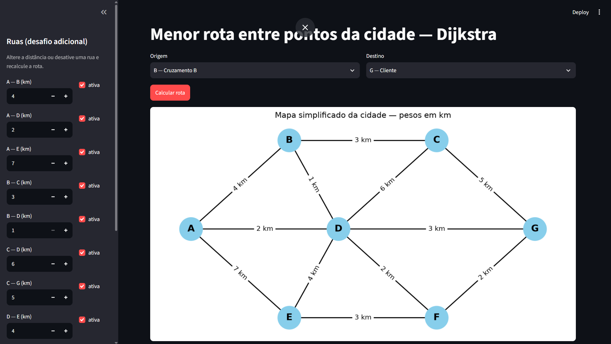

# Relatório — Caminho mínimo com Dijkstra

**Grupo:**

| Nome | RM |
|---|---|
| Nicolas Marinho dos Santos | RM563185 |
| Raphael Naome Taketa Silva | RM562321 |
| Victor Ribeiro Guimarães Lira | RM566213 |
| Felipe de Andrade Godoi | RM566209 |

## Como executar

```bash
pip install -r requirements.txt
streamlit run app.py        # interface gráfica
python test_dijkstra.py     # testes
```

## Arquivos

- `grafo.py`: dados do mapa, grafo e algoritmo de Dijkstra
- `desenho.py`: desenho do grafo com o caminho em vermelho
- `app.py`: interface Streamlit
- `test_dijkstra.py`: testes automatizados
- `capturas/`: imagens dos resultados

## Como o algoritmo funciona

1. Todas as distâncias começam em infinito, menos a origem, que começa em 0.
2. A cada passo, pegamos o ponto com menor distância na fila e tentamos melhorar a distância dos vizinhos (distância atual + peso da rua).
3. No final, voltamos do destino até a origem seguindo os predecessores para montar o caminho. Se o destino não foi alcançado, aparece "Não existe caminho".

## Testes

| Origem → Destino | Caminho | Distância |
|---|---|---|
| A → G | A → D → G | 5 km |
| G → A | G → D → A | 5 km |
| A → C | A → D → B → C | 6 km |
| E → C | E → D → B → C | 8 km |
| B → F | B → D → F | 3 km |

- **A → G:** as outras rotas são mais longas, como A-D-F-G (6 km) e A-B-D-G (8 km).
- **G → A:** dá o mesmo resultado de A → G porque as ruas são de mão dupla.
- **A → C:** mostra que o Dijkstra olha os pesos: A-B-C tem menos ruas, mas custa 7 km; passando por D custa 6 km.
- **E → C:** as outras rotas são mais longas, como E-F-D-B-C (9 km) e E-D-C (10 km).
- **B → F:** B-D (1 km) + D-F (2 km) = 3 km; qualquer outra rota até F passa de 3 km.
- Se origem e destino forem iguais, a aplicação mostra um aviso.
- Desativando as ruas C-G, D-G e F-G, o ponto G fica isolado e aparece "Não existe caminho".

## Desafio adicional

Na barra lateral é possível mudar a distância de cada rua ou desativá-la.

Exemplo: desativando a rua **D-G**, a rota A → G muda de A-D-G (5 km) para **A-D-F-G (6 km)**, porque o algoritmo recalcula usando só as ruas ativas.

## Capturas

- `capturas/rota_A_G.png`, `rota_G_A.png`, `rota_A_C.png`, `rota_E_C.png`: testes
- `capturas/rota_A_G_sem_DG.png`: desafio com a rua D-G desativada


- 
